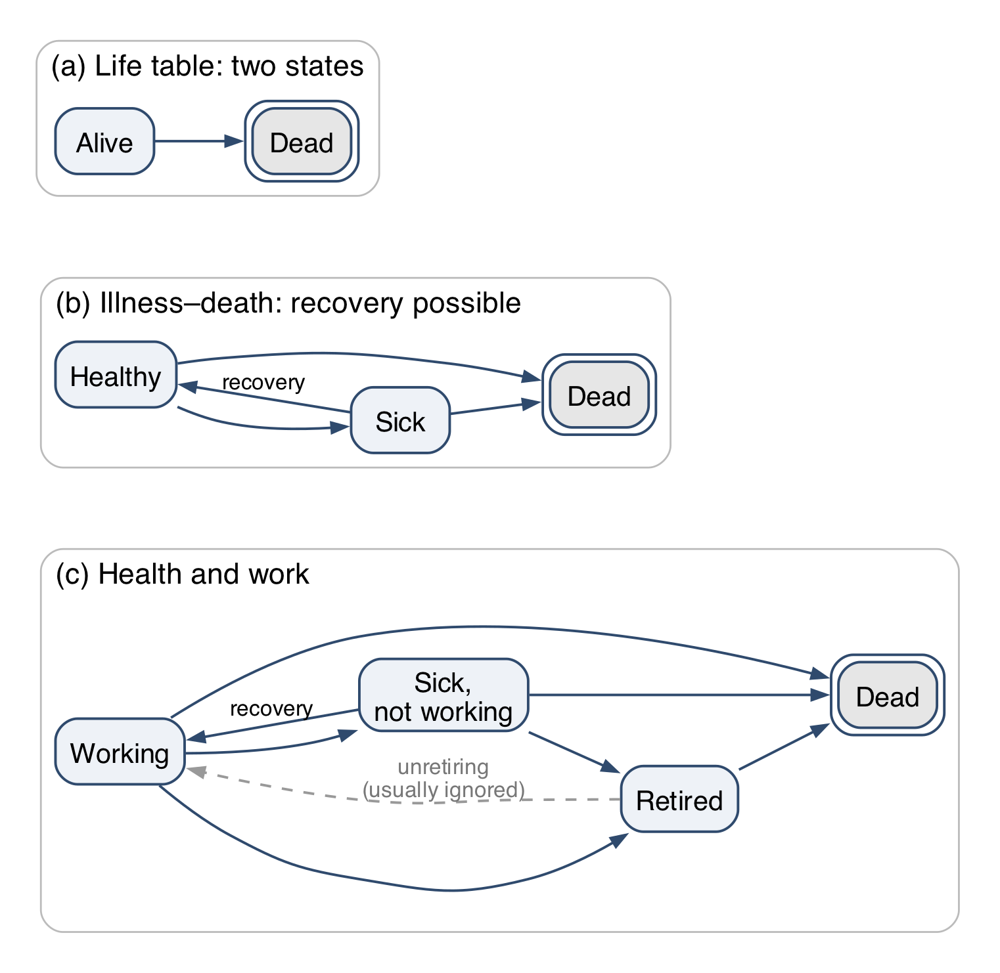
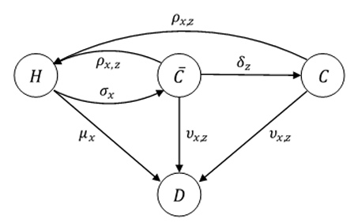
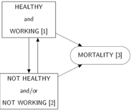
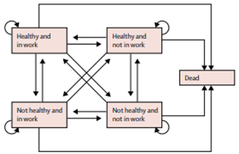
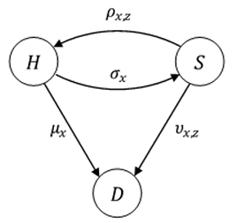

<!--
=====================================================================
  DRAFTING NOTES (not rendered)
=====================================================================
See NOTES.md in this folder for constraints, agreed structure, template
mechanics and the decisions log.

Source paper: reports/ifoa/HWLE_Methods_v17.docx (v1, 1 Aug 2026).
Render:       quarto render presentations/ifoa/hwle_ifoa_life_2026.qmd

Constraints (David, 28 Aug):  45 min = 35 present + 10 Q&A;
  2–3 min/slide → 10–18 slides; IFoA template mandatory; deadline 18 Oct.

Conventions:
  * "❓ ..." slides = questions for the Working Party. DELETE before
    submission. "- [ ]" open, "- [x]" resolved; indented lines below a
    question are the interim answers.
  * "[PRESENTER · n min]" in slide titles marks hand-overs/timings.
    Strip before submission (or keep in speaker notes).
  * "TODO:" = content still needed.
  * MAIN vs SUPPLEMENT: the deck is split into a Main deck (target ~12
    content slides) and a Supplement, grouped by the main section each
    slide would fold back into. Review the supplement each iteration:
    promote / keep as appendix / delete.
  * media/image1–5.png are extracted from the docx (Lynch, Parker,
    CMI 3-state, CMI 4-state, Parker Table 10).
=====================================================================
-->

# ❓ Presentation-wide questions (REMOVE THIS SECTION BEFORE FINALISING)

<!-- Deck layout: [❓ questions] → MAIN DECK → SUPPLEMENT. -->

## ❓ Format and logistics

- [x] **Slot length?**
    - 45 minutes including Q&A: 35 min presenting + 10 min Q&A. 2–3 min/slide → 10–18 slides.
    - Call: David's last talk here had 15 slides and was rushed; realistic target **~12 content slides**. Draft is at 15 — cut/merge candidates flagged below.
- [x] **Presenter(s)?**
    - Three presenters with hand-over: David → Chris → Jon → David → all for Q&A.
- [x] **Session type?**
    - Workshop stream (?) — room of perhaps 50; ~95% actuaries, rest life-insurance industry delegates; mix of technical and commercially minded. Abstract promised a not-very-technical talk.
- [x] **Branding / template**
    - IFoA template mandatory. Supplied 28 Aug; stored as `ifoa_life_template.pptx`; pandoc-compatible copy `ifoa_life_reference.pptx` is wired into the YAML. See NOTES.md.
- [x] **Submission deadline**
    - 18 October 2026.
- [ ] **Disclaimer slide** — standard IFoA Working Party disclaimer wording.
    - [ ] David to supply wording to Jon.
- [ ] **CMI data permissions** — which numbers/diagrams can be shown publicly.
    - Diagrams believed OK as they pre-date subscriber restrictions.
    - [ ] David to confirm no retrospective change in permissions.
- [x] **Recording / slides shared afterwards?**
    - Not recorded. Might be shared on restricted virtual learning environment for actuaries.

## ❓ Audience and pitch

- [x] **Assumed audience**
    - Mostly life and health actuaries.
- [ ] **Core message** — choose ONE to lead with (or a (d) of our own):
  - (a) "Admin data can complement/replace survey data for HWLE" (methods)
  - (b) "HWPLE is a useful descriptive statistic for morbidity bases" (insurance)
  - (c) "HWLE has policy relevance to SPA / pensions adequacy / Keep Britain Working" (policy)
  - Call leaned towards: *which data sources are best for these models — survey or CMI? — and the value of **triangulating** independent approaches.* Deferred to next call.
- [ ] **Avoid double-counting** multi-state methods between Jon's and David's sections — decide who explains the model once.
- [x] **How much literature review?**
    - ≈ 5 min, folded into Jon's "survey data" section.
- [x] **How much maths?**
    - Diagrams sufficient; no additional equations.
- [x] **Show the Excel HWP Tool?**
    - No.
- [x] **Link to UKHLS / economic inactivity work?**
    - Yes, briefly — Jon's section.

## ❓ Content decisions affecting several slides

- [ ] **Which headline numbers?** Draft uses *age 50, retire at 65*: HWPLE 13.1–13.8 yrs, NNPLE 0.44–1.21 yrs. Also age-20 (42.3 / 1.08 yrs)?
- [ ] **OC1 vs OC2 "counter-intuitive" ordering** — talking point or downplay?
- [ ] **Female OC3/OC4 credibility caveat** — footnote or one caveat line?
- [ ] **Terminology:** *HWPLE / NNPLE* throughout, or *HWLE* in titles with "partial" defined once?
- [ ] **Figures needed:**
  - [x] HWPLE / NNPLE by starting age × OC (line chart — generated in this file)
  - [ ] Stacked bar: % of working life to 65 in W / NN / Dead, ages 20 vs 50
  - [ ] Redrawn 4-state HWP Tool diagram (Figure 5 is *missing* from the docx)
- [x] **Exact title of the Mayfield review**
    - *Keep Britain Working* is the current name (renamed from *Get Britain Working*; name change discussed at the 28 Aug call).
- [ ] **Darzi review** (2024, NHS-focused) — mention in Chris's policy backdrop? Agreed worth a mention, but it is NHS- rather than workforce-focused; decide on prominence.
- [x] **Personal intros**
    - Each presenter gives a slightly longer personal intro when taking over their section; David does a brief one at the start.
- [x] **Presenter names** — Chris Martin; three presenters on behalf of the wider WP, whose names appear on title slide and WP slide.
- [x] **Meeting transcript** (Pocket AI, 28 Aug call) — reviewed; points folded into NOTES.md and these checklists.
- [ ] **Chris's content** — Chris will draft as a text document for Jon to fold in here.

---

# MAIN DECK

## Agenda [DAVID · 2–5 min]

1. Background to the Healthy Workforce Working Party — *David*
2. Why this matters: Keep Britain Working, and a clinician's view — *Chris*
3. From survey data to administrative data: multi-state models — *Jon*
4. Healthy working life expectancy from CMI income protection rates — *David*
5. Q&A and next steps — *all*

David: brief personal intro here; Chris and Jon introduce themselves on taking over.

::: {.notes}
Standard IFoA disclaimer to be added as slide 2 once David supplies wording.
:::

## The Healthy Workforce Working Party [DAVID · 5 min]

TODO (David): remit, membership, history, outputs to date.

- Members: D. R. Beddows, Z. Woodroffe, J. Minton, D. Bates, S. Batrakova, C. Martin, R. Pal, C. Zhang
- Mix of actuarial, clinical and public-health backgrounds
- First output: *Healthy working life expectancy methods* paper (v1, Aug 2026) + public Healthy Workforce Projection Tool
- Support from the CMI and IFoA Professional Communities team

## ❓ Questions — Agenda & Working Party

- [ ] David: one slide or two for WP background?
- [ ] Do we name the paper and say where it will be available (IFoA website? journal?)
- [ ] Should the disclaimer be its own slide (costs one of the 18) or in the footer?

---

# Why this matters [CHRIS · 10 min]

## The policy backdrop

TODO (Chris): review of the reports — Darzi (2024; NHS-focused but discussed the health of the working population; cited when the WP was set up), Mayfield *Keep Britain Working* (2025; formerly *Get Britain Working*), and 2026 outputs from the Health Foundation and think tanks (TODO: confirm which). Aim: reflect what is actually in them and bring them to life.

- Economic inactivity due to ill-health: c. 2.8 m people (TODO: latest figure)
- Employers' role in preventing health-related job loss; "the cost of doing nothing"
- Government target of 80% employment rate
- State Pension Age rising 66 → 67 (2026–28) → 68 (2044–46): can people *work* that long in health?

## A clinician's perspective

TODO (Chris): reflections as a former occupational physician and GP — the coal-face, human side of leaving work through ill-health.

- What "long-term sick" looks like in a consulting room
- Recovery and return to work: why *duration* matters
- Mental health vs. physical health; own-occupation vs. any-occupation

## ❓ Questions — Why this matters

- [ ] Chris: how much weight on Darzi (NHS) vs. Mayfield (workforce)? One bullet or its own slide?
- [ ] Which Health Foundation / think-tank 2026 outputs to cite?
- [ ] Any 2026 news items to cite (new legislation, statistics releases)?
- [ ] Is 3 slides right for 10 minutes, or does the clinical section want a case-study slide?
- [x] The "what we can measure" slide overlaps with Jon's opener — moved to Supplement.

---

# From survey data to administrative data [JON · 5 min]

## Multi-state models: a reminder

:::: {.columns}
::: {.column width="55%"}

:::
::: {.column width="45%"}
- A life table is a two-state model. Add states, and the same machinery gives **expected time in each state**: HWLE is expected years *working*.
- **Absorbing** states can't be left (death, double border). **Non-absorbing** states can: sickness allows recovery.
- Retirement is usually modelled as one-way, but in life it isn't quite absorbing.
:::
::::

::: {.notes}
Jon Minton, Knowledge Tree and Butterfly: one-line intro on taking over from Chris.

About 1.5 minutes. A reminder, not a lecture: everyone here has seen multi-state life tables. Panel (a) is the life table; (b) adds a state you can leave; (c) is the shape of the health-and-work problem. Double border = absorbing.

Retirement: "Hotel California": you can check out any time you like, but you can never leave. In the model it is one-way; in life people do unretire, and pension-age policy cares about exactly that.
:::

## Same machinery, two traditions

:::: {.columns}
::: {.column width="50%"}
**Health economics**

- Markov *cohort* models with many states, recovery included
- Each state carries a **cost** and a **utility** (quality of life)
- Question: *is this intervention worth paying for?* (cost per QALY)
- Usually parameterised from trials and **surveys**
:::
::: {.column width="50%"}
**Actuarial**

- Multi-state models from **dated events** (time-to-event)
- Rates can depend on **duration** in a state
- Question: *how long, and at what cost, in each state?*
- Usually parameterised from **experience data**

*HWLE sits between them: a public-health question answered with actuarial tools.*
:::
::::

::: {.notes}
About 1.5 minutes. The point for this audience: health economists and actuaries build the same kind of model and ask different questions of it. Health economics attaches utilities and costs to states to decide what to fund; actuaries attach durations and money to states to price and reserve. Working-age ill health is a place where both questions matter: the policy question (Keep Britain Working, from Chris) and the insurance question (David's section).
:::

## What survey data give us, and what they force on us

:::: {.columns}
::: {.column width="50%"}
**Surveys give us** (ELSA, Understanding Society)

- The whole population, including people *not* working or insured
- Health *and* work status, observed together
- Accessible, well understood, long-running
:::
::: {.column width="50%"}
**Surveys force on us**

- Roughly **annual waves**: status at snapshots, not dated events
- So: **one-year Markov steps**; moves between waves are unseen
- No **duration** since onset, so recovery can't depend on it
- Self-reported states; tens of thousands of people at best

→ Administrative data relax these. **Over to David:** HWLE from insurers' claims.
:::
::::

::: {.notes}
About 2 minutes, ending on the hand-off. Survey data are the only view of the whole population, which is why every published UK HWLE estimate so far uses them (ELSA: Lynch 2022, Parker 2020; supplement). But annual waves mean the model can only be a one-year Markov chain: what happened between interviews is invisible, and there is no clock on how long someone has been sick. Actuarial time-to-event data give dated claim inceptions and recoveries, with recovery depending on how long the claim has run. Hand over: "David will show what that buys us: healthy working life expectancy from CMI income protection experience."
:::

## ❓ Questions — Survey approaches

- [x] 5 or 10 minutes? **5, three slides** (agreed with David and Chris, 11 Sep).
- [x] "Current approaches" heading dropped (11 Sep). Lynch/Parker literature slide and the UKHLS counterfactual slide moved to Supplement · Survey approaches.
- [x] Multi-state modelling explained **once, here**, as a reminder; David's section uses it without re-explaining.
- [ ] David: does the hand-off line match your HWLE definition (expected years working, 50 to 65, partial expectancy)? Reword to suit.
- [ ] Triangulation message (survey ≈ 12.5 yrs vs CMI ≈ 13.5 yrs): stays in David's comparison slide.
- [ ] Health-economics column: add one worked example (e.g. a return-to-work intervention's cost per QALY) or keep generic?

---

# HWLE estimates with CMI rates [DAVID · 10 min]

## The CMI income protection data

:::: {.columns}
::: {.column width="45%"}

:::
::: {.column width="55%"}
- IP11 rates (WP 131): 2007–2016, **c. 4.8 m policy-years**, c. 106k claims
- By sex × deferred period × **4 occupation classes**, ages 17–64
- Claim inceptions, recoveries, claimant deaths
- Recovery and death rates depend on **duration** of claim
- Claims, not sicknesses: sickness inside the deferred period is unobserved
:::
::::

## The Healthy Workforce Projection Tool

TODO: redraw 4-state diagram (W, NN, R, D) — Figure 5 missing from the paper.

| Rate | Basis |
|---|---|
| Working → Not-healthy-not-working | IP11 claim inception, **4-week** deferred period |
| NN → Working (recovery), NN → Dead | IP11 rates, by duration in NN |
| Working / Retired → Dead | ONS UK 2022–24 |
| Retirement | 100% at age 65 |

- Everyone starts *working*; one transition per year; run separately for OC1–OC4
- Output: **partial** expectancies to 65 — HWPLE and NNPLE

## Results: a working 50-year-old, retiring at 65

| Occupation class | HWPLE F | HWPLE M | **All** | NNPLE F | NNPLE M | **All** |
|---|---|---|---|---|---|---|
| OC1 professional / clerical | 13.5 | 13.7 | **13.6** | 0.91 | 0.56 | **0.73** |
| OC2 light manual / supervisory | 13.7 | 13.8 | **13.8** | 0.71 | 0.44 | **0.57** |
| OC3 manual, non-hazardous | 13.3 | 13.6 | **13.5** | 1.03 | 0.64 | **0.83** |
| OC4 heavy manual / hazardous | 13.1 | 13.4 | **13.3** | 1.21 | 0.76 | **0.98** |

Of 15 years: **13.1–13.8 yrs working**, **0.4–1.2 yrs not-healthy-not-working**, remainder deaths.
Men > women; OC2 > OC1 > OC3 > OC4. Data centred on 2011; female OC3/OC4 thin.

## How does it compare, and what are the caveats?

- Parker (ELSA, survey): ≈ **12.5 yrs** working from 50 (10.8 healthy + 1.7 not-healthy-but-working) vs. our **13.3–13.8** — direction expected: insured lives, ≥4-week claims, capped at 65
- **Strengths**: objective dated events; incidence not prevalence; duration-dependent recovery; explicit retirement age; large exposure
- **Caveats**: insured segment, not the population; claims as proxy for sickness; excluded conditions; everyone starts working; yearly steps; rates restricted to CMI subscribers
- **Uses**: HWPLE as an intuitive summary of a morbidity basis; benchmarking IP assumptions; pensions projections allowing for sickness; policy on SPA and benefits

## ❓ Questions — CMI section

- [x] By-age chart moved to Supplement; section now 4 slides. Fold back if David wants it for 10 min.
- [ ] Who redraws the HWP Tool 4-state diagram, and in what tool?
- [ ] OC1 < OC2: offer hypotheses on the slide (selection, own-occupation definitions, mental-health claims in OC1) or "further work"?
- [ ] Is the Parker "10.81 + 1.67 = 12.5" comparison fair enough to put on a slide? Sanity-check with lead author.
- [ ] Combine comparison + caveats + uses on one slide (as drafted) or split into two?
- [ ] Confirm CMI is happy with the data-volume figures being shown.

---

## Next steps for the Working Party [ALL · Q&A 10 min]

- Monthly time steps; SPA evolution and early-retirement scenarios
- Trends over successive CMI investigation periods; more granular cohorts
- Survey-based benchmarks (ELSA, **UKHLS**) for the whole working-age population
- Starting states other than "working"
- Public-authority sickness/incapacity benefit data; international comparisons
- **Questions?**

## Thank you

IFoA Healthy Workforce Working Party

Correspondence: David Beddows, c/o professional.communities@actuaries.org.uk

Paper: *Healthy working life expectancy methods* (IFoA HWWP, 2026) · Public HWP Tool

## ❓ Questions — Close

- [ ] Prioritise three "next steps" or keep all?
- [ ] Name a next deliverable and date (v2 tool? journal submission?)
- [ ] Contact details: David only, or all presenters? QR code to the paper?
- [ ] Merge "next steps" into the "thank you" slide to save one?

---

# SUPPLEMENT — material held back from the main deck

<!--
Supplement slides are grouped under the MAIN section they would fold back
into. Review each: promote to main, keep as appendix, or delete.
Main-deck slide count is tracked in NOTES.md.
-->

## ❓ Supplement — fold-back review

- [ ] Go through each supplement slide and mark: **promote** / **appendix** / **delete**
- [ ] Anything promoted must displace something — main target is ~12 content slides
- [ ] Anything in main that is really supplementary detail → move down here

# Supplement · Why this matters

## What we can — and cannot — measure

- Life expectancy: two states, well measured
- Healthy life expectancy: needs a definition of "healthy"
- Working life expectancy: needs a definition of "working"
- **Healthy working life expectancy**: both — and the data to observe the transitions
- Systematic review (Parker et al. 2020a): "no current and reliable estimates" for the UK

## UK State Pension Age timetable

| Legislation | Period | Men | Women |
|---|---|---|---|
| Pre-2010 | | 65 | 60 |
| Pensions Act 1995 | 2010–2016 | 65 | 60→63 |
| Pensions Act 2011 | 2016–2020 | 65→66 | 63→66 |
| | 2021–2025 | 66 | 66 |
| Pensions Act 2014 | 2026–2028 | 66→67 | 66→67 |
| | 2029–2043 | 67 | 67 |
| Pensions Act 2007 | 2044–2046 | 67→68 | 67→68 |
| | 2047 onwards | 68 | 68 |

# Supplement · Survey approaches

## Survey-based HWLE so far (ELSA)

- All published UK HWLE estimates use **survey data**, mainly ELSA (age 50+)
- **Sullivan method**: life table × cross-sectional *prevalence* of health states
- **Multi-state (Markov) models**: transition rates between states, estimated from repeated waves
  - Lynch et al. 2022 — 3 states, ELSA waves 2–6, n ≈ 11,500
  - Parker et al. 2020 — 5 states, ELSA waves 1–6, n ≈ 15,300; HWLE at 50 ≈ **10.8 years** for those healthy and working at 50

:::: {.columns}
::: {.column width="50%"}

:::
::: {.column width="50%"}

:::
::::

## Modelling transitions in UKHLS (Understanding Society)

- Household panel, waves 1–13 (2009–2022), all working ages — not just 50+
- Economic status: employed / unemployed / long-term sick / student / carer / retired / other
- Multinomial model of *next-wave* status given *this-wave* status, age, sex — a Markov chain from survey data
- Add health (SF-12 mental & physical scores, limiting illness) and ask **counterfactual** questions: what if health were better?
  - e.g. improving mental and physical health by 1 SD → ~30% fewer long-term sick

TODO: one figure — transition matrix or PAF-style bar chart from reports/ifoa/ work.

## What survey data can and cannot do

:::: {.columns}
::: {.column width="50%"}
**Strengths**

- Exists, well understood, accessible
- Representative of the whole population
- Covers people *not* currently working
- Observes health *while* working
:::
::: {.column width="50%"}
**Weaknesses**

- Self-reported health and work status
- Prevalence at annual snapshots, not dated events
- Transitions within a year unobserved
- Tens of thousands of respondents at best
:::
::::


## Administrative vs. survey data — full trade-offs

:::: {.columns}
::: {.column width="50%"}
**Administrative — for**

- Objective events, not self-report
- Incidence, not prevalence
- Exact dates → accurate exposure by age and duration
- Sub-annual transitions observable
- Hundreds of thousands of lives/yr
:::
::: {.column width="50%"}
**Survey — for**

- Exists, well understood, accessible
- More representative of the population
- Covers people not currently working
- Captures health while working
:::
::::

## Definitions of health and work states

| Study | Healthy / not-healthy | Working / not-working |
|---|---|---|
| Lynch 2022; Parker 2020 (ELSA) | Self-reported long-standing illness that limits activities | Paid work or self-employment in the month before interview |
| CMI IP11 | Not claiming = "working" (health unknown); claiming = not-healthy-not-working per policy trigger | As left |

# Supplement · CMI rates

## Results by starting age

```{r}
#| label: fig-by-age
#| fig-cap: "HWPLE and NNPLE to age 65 by starting age and CMI occupation class (sexes combined). Source: HWP Tool, Tables 9a–9d."
library(tidyverse)
res <- tribble(
  ~oc, ~age, ~hwple, ~nnple,
  "OC1", 20, 42.3, 1.08, "OC1", 30, 32.5, 1.04, "OC1", 40, 23.0, 0.96, "OC1", 50, 13.6, 0.73, "OC1", 60, 4.7, 0.21,
  "OC2", 20, 42.3, 1.04, "OC2", 30, 32.7, 0.94, "OC2", 40, 23.1, 0.81, "OC2", 50, 13.8, 0.57, "OC2", 60, 4.7, 0.15,
  "OC3", 20, 41.8, 1.46, "OC3", 30, 32.2, 1.34, "OC3", 40, 22.7, 1.17, "OC3", 50, 13.5, 0.83, "OC3", 60, 4.6, 0.23,
  "OC4", 20, 41.4, 1.80, "OC4", 30, 31.8, 1.63, "OC4", 40, 22.4, 1.39, "OC4", 50, 13.3, 0.98, "OC4", 60, 4.6, 0.26
)
res |>
  pivot_longer(c(hwple, nnple), names_to = "metric", values_to = "years") |>
  mutate(metric = recode(metric, hwple = "HWPLE (years to 65)", nnple = "NNPLE (years to 65)")) |>
  ggplot(aes(age, years, colour = oc)) +
  geom_line() + geom_point() +
  facet_wrap(~metric, scales = "free_y") +
  labs(x = "Starting age", y = NULL, colour = "Occupation class") +
  theme_minimal(base_size = 14) +
  theme(legend.position = "bottom")
```

::: {.notes}
Age 20: 94% of working life to 65 spent working, 2.4% NN, 3.6% lost to death. Age 50: 90.7% / 4.9% / 4.4%.
:::

## CMI occupation classes

| Class | Description |
|---|---|
| **OC1** | Professional, managerial, executive, administrative and clerical; not engaged in manual labour |
| **OC2** | Master craftsmen and tradesmen in management/supervision; skilled operatives in light manual, non-hazardous work |
| **OC3** | Skilled operatives in manual, non-hazardous work |
| **OC4** | Skilled and semi-skilled operatives in heavy manual work or subject to special hazard |

## CMI 3-state sickness model (CMIR 12, 1991)



## Transition rates in the HWP Tool

| Rate | Description | Basis |
|---|---|---|
| nn(x) | W → NN | CMI IP11 claim inception, DP4 |
| w(x,z) | NN → W (recovery) | CMI IP11 recovery rates |
| dw(x), dr(x) | mortality, W and R | ONS UK 2022–24 |
| dnn(x,z) | mortality in NN | CMI IP11 claimant mortality |
| rw(x), rnn(x) | retirement | 1 at age 65; 0 otherwise |

x = age, z = duration in NN. Monthly IP11 rates in claim years 1–2 collapsed to yearly.

## Data volumes behind the rates

| | In force (start yr) | Claims (inceptions) | Claims (recoveries) |
|---|---|---|---|
| Total IP11 | 4.76 m | 105,957 | 98,659 |
| DP4 | 522 k (11%) | 17,745 (17%) | 16,894 (17%) |
| Ages 50–64 | 1.43 m (30%) | 50,019 (47%) | 47,366 (48%) |

Rates used rest on c. 140k–430k records vs. c. 12–15k ELSA respondents.

## Life expectancy from the HWP Tool

| Starting age | Females | Males | Overall |
|---|---|---|---|
| 20 | 62.3 | 58.8 | 60.4 |
| 30 | 52.6 | 49.1 | 50.8 |
| 40 | 42.9 | 39.8 | 41.3 |
| **50** | **33.5** | **30.7** | **32.1** |
| 60 | 24.9 | 22.4 | 23.5 |

ONS 2022–24 basis; near-identical across OCs because mortality in W is not OC-specific.

# Supplement · Close

## Key references

- Lièvre A. et al. (2007) *J Nutr Health Aging* 11:508–514
- Parker M. et al. (2020a) *Soc Indic Res* 150:337–350; (2020b) *Lancet Public Health* 5:e395–e403
- Lynch M. et al. (2022) *Sci Rep* 12:2408
- Dudel C. (2021) *Lancet Healthy Longev* 2:e629
- IFoA CMI Working Papers 109 (2018), 131 (2020), 136 (2021); IP11 Briefing Note (2020)
- IFoA Healthy Workforce Working Party (2026) *Healthy Workforce Projection Tool (public version)*
- Mayfield, C. (2025) *Keep Britain Working* — independent review (formerly *Get Britain Working*)
- Darzi, A. (2024) *Independent investigation of the NHS in England*
